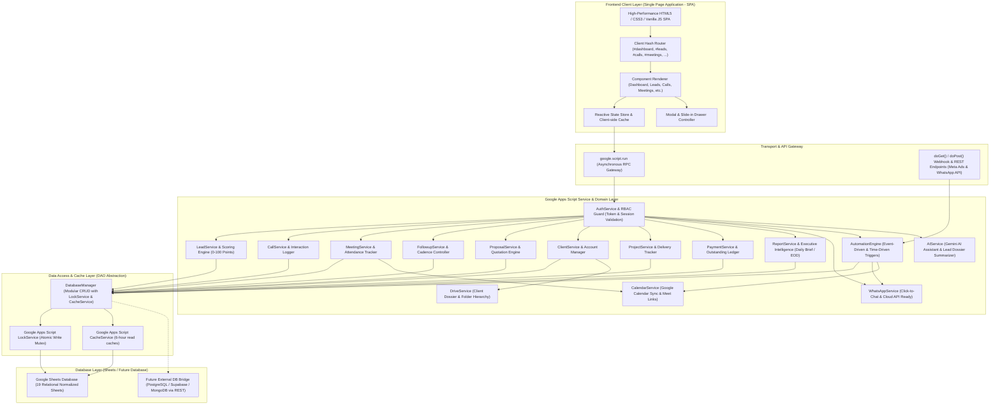
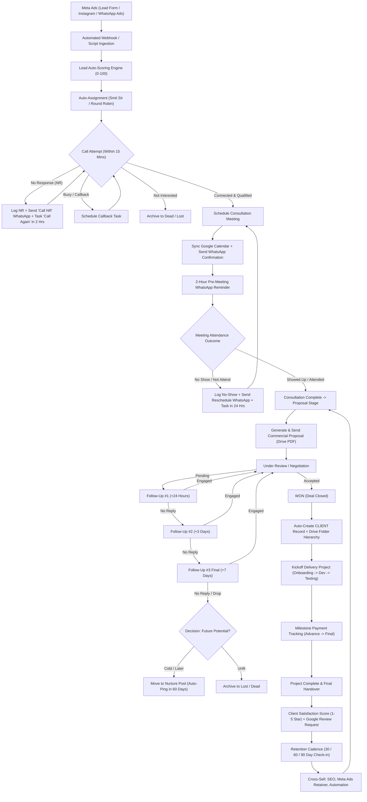

# BULLETPROOF BRANDS — ENTERPRISE CRM & SALES AUTOMATION SYSTEM
## Production Architecture & Database Specification Document
**Version:** 2.0.0-PROD  
**Author:** Senior Full-Stack Software Architect & Google Apps Script Principal Engineer  
**Client / Brand:** Bulletproof Brands (*"Impossible to Ignore"*)  
**Target Environment:** Google Apps Script Web App (SPA) + Google Sheets Relational Database + Multi-Cloud Extensibility  

---

## SECTION A: COMPLETE SYSTEM ARCHITECTURE



### Architectural Principles:
1. **Multi-Tier Separation of Concerns**: The frontend has zero direct sheet manipulation; all actions pass through the `DatabaseManager` Data Access Object (DAO) via strongly typed service domains (`LeadService`, `MeetingService`, etc.).
2. **Pluggable Storage Abstraction**: The `DatabaseManager` isolates all Google Spreadsheet API calls (`SpreadsheetApp`). To migrate to PostgreSQL, Supabase, or MongoDB later, only the `DatabaseManager.gs` adapter needs updating—zero client-side code changes.
3. **Atomic Concurrency Protection**: High-frequency operations (lead creation, status progression, payments) are wrapped in `LockService.getScriptLock()` with a 15-second timeout to prevent race conditions or duplicate writes.
4. **Sub-second Response Times**: Dashboard summaries and KPI counts are cached via `CacheService.getScriptCache()`. When updates occur, specific cache keys are invalidated immediately.
5. **Universal Contact Normalization**: Phone numbers are automatically sanitized and normalized to E.164 standard (e.g. `9924035386` -> `919924035386`) across all modules.

---

## SECTION B & C: DATABASE SCHEMA (19 RELATIONAL SHEETS)

Every sheet uses auto-generated, collision-free, human-readable prefixed IDs (e.g., `LD-10001`, `MTG-30001`, `PRP-50001`). No record ever relies on raw sheet row numbers.

### 1. `USERS`
| Column | Type | Nullable | Primary / Foreign Key | Description |
|---|---|---|---|---|
| `user_id` | String | No | PK | Prefixed ID (`USR-1001`) |
| `name` | String | No | - | Full employee name (e.g. Smit Sir, Rahul, Jay) |
| `email` | String | No | Unique Index | Google Account Email used for authentication |
| `role` | String | No | - | `Super Admin`, `Admin`, `Manager`, `Sales`, `Employee` |
| `phone` | String | Yes | - | Direct phone number |
| `avatar_url` | String | Yes | - | Profile photo or initial avatar placeholder |
| `status` | String | No | - | `Active`, `Inactive`, `Suspended` |
| `created_at` | ISO DateTime | No | - | Record timestamp |
| `last_login_at`| ISO DateTime | Yes | - | Last authenticated session |

### 2. `LEADS`
| Column | Type | Nullable | Primary / Foreign Key | Description |
|---|---|---|---|---|
| `lead_id` | String | No | PK | Prefixed ID (`LD-10001`) |
| `created_date` | Date (YYYY-MM-DD) | No | - | Date of inquiry |
| `created_time` | Time (HH:mm) | No | - | Time of inquiry |
| `name` | String | No | - | Contact full name (e.g. Chiragbhai Moradiya) |
| `phone` | String | No | Index | Normalized phone (e.g. 9924035386) |
| `whatsapp_number` | String | Yes | - | WhatsApp E.164 number (`919924035386`) |
| `email` | String | Yes | - | Business email address |
| `company_name` | String | Yes | - | Business / Enterprise name (e.g. Siriocraft) |
| `website` | String | Yes | - | Company URL (`https://www.siriocraft.com/`) |
| `industry` | String | Yes | - | Industry (e.g. E-commerce, Manufacturing, Retail) |
| `business_type` | String | Yes | - | B2B, B2C, D2C, Agency |
| `location` | String | Yes | - | City / State (e.g. Surat, Ahmedabad, Mumbai) |
| `source` | String | No | - | `Meta Ads`, `Website`, `WhatsApp`, `Referral`, `Google`, `Manual` |
| `campaign` | String | Yes | - | Marketing Campaign name (e.g. Business Owners Surat) |
| `ad_set` | String | Yes | - | Meta AdSet identifier |
| `ad` | String | Yes | - | Meta Ad Creative name |
| `form` | String | Yes | - | Instant Lead Form ID |
| `utm_source` | String | Yes | - | UTM tracking parameter |
| `utm_medium` | String | Yes | - | UTM tracking parameter |
| `utm_campaign` | String | Yes | - | UTM tracking parameter |
| `utm_content` | String | Yes | - | UTM tracking parameter |
| `utm_term` | String | Yes | - | UTM tracking parameter |
| `assigned_employee` | String | No | FK -> `USERS.name` | Assigned sales owner (e.g. Smit Sir) |
| `lead_status` | String | No | Index | `New`, `Contacted`, `Qualified`, `Meeting`, `Proposal`, `Negotiation`, `Won`, `Lost`, `Nurture` |
| `sub_status` | String | Yes | - | `No Response`, `Call Again`, `Show`, `No Show`, `Rescheduled`, `Not Interested` |
| `lead_temperature` | String | No | - | `HOT`, `WARM`, `COLD`, `LOW` |
| `lead_score` | Number | No | - | Computed Score (0 to 100) |
| `budget` | String | Yes | - | E.g. `₹50,000–₹1,00,000`, `₹1,00,000–₹3,00,000` |
| `expected_start_date`| String | Yes | - | Target project launch timeline |
| `decision_maker` | String | Yes | - | `Yes`, `No`, `Evaluating with Partner` |
| `requirements` | String | Yes | - | Comma-separated: `Website, Shopify, Meta Ads, SEO` |
| `problems` | Text | Yes | - | Key client pain points & objections |
| `notes` | Text | Yes | - | Internal conversation remarks & background |
| `last_contact_date` | Date | Yes | - | Date of most recent communication |
| `last_contact_type` | String | Yes | - | `Call`, `WhatsApp`, `Meeting`, `Email` |
| `next_action` | String | No | - | Mandatory: next promised step |
| `next_action_date` | Date | No | Index | Scheduled date of next action |
| `next_action_time` | Time | Yes | - | Scheduled time of next action |
| `created_by` | String | No | FK -> `USERS.user_id` | Originating operator or SYSTEM |
| `updated_by` | String | No | FK -> `USERS.user_id` | Last editor operator |
| `updated_date` | ISO DateTime | No | - | Last modification timestamp |

### 3. `CALLS`
| Column | Type | Nullable | Primary / Foreign Key | Description |
|---|---|---|---|---|
| `call_id` | String | No | PK | Prefixed ID (`CAL-20001`) |
| `lead_id` | String | No | FK -> `LEADS.lead_id` | Associated lead |
| `client_name` | String | No | - | Client name snapshot |
| `phone` | String | No | - | Phone dialed |
| `date` | Date | No | Index | Call execution date |
| `time` | Time | No | - | Call timestamp |
| `employee` | String | No | FK -> `USERS.name` | Caller agent |
| `status` | String | No | - | `Connected`, `No Response`, `Busy`, `Switched Off`, `Wrong Number`, `Call Back Later`, `Interested`, `Not Interested`, `Qualified` |
| `duration` | String | Yes | - | E.g. `04:32`, `00:00` |
| `notes` | Text | Yes | - | Discussion notes |
| `next_call_date` | Date | Yes | - | Scheduled callback date |
| `next_call_time` | Time | Yes | - | Scheduled callback time |
| `recording_url` | String | Yes | - | Call audio / Drive URL |
| `created_at` | ISO DateTime | No | - | Log creation timestamp |

### 4. `MEETINGS`
| Column | Type | Nullable | Primary / Foreign Key | Description |
|---|---|---|---|---|
| `meeting_id` | String | No | PK | Prefixed ID (`MTG-30001`) |
| `lead_id` | String | No | FK -> `LEADS.lead_id` | Associated lead |
| `client_name` | String | No | - | Contact name (e.g. Chiragbhai Moradiya) |
| `phone` | String | No | - | Client contact |
| `date` | Date | No | Index | Scheduled meeting date (`30-09-2026`) |
| `time` | Time | No | - | Scheduled meeting time (`04:00 PM`) |
| `meeting_person` | String | No | FK -> `USERS.name` | Executive (e.g. Smit Sir) |
| `meeting_type` | String | No | - | `Office Meeting`, `Client Office`, `Google Meet`, `Zoom`, `Phone Call` |
| `address` | String | Yes | - | E.g. `Surat`, Client office address, or Meet link |
| `website` | String | Yes | - | Company URL (`https://www.siriocraft.com/`) |
| `status` | String | No | Index | `Scheduled`, `Confirmed`, `Showed Up`, `No Show`, `Rescheduled`, `Cancelled`, `Completed` |
| `notes` | Text | Yes | - | Meeting agenda & minutes |
| `assigned_employee`| String | No | FK -> `USERS.name` | Assigned host |
| `calendar_event_id`| String | Yes | - | Google Calendar Event ID |
| `meet_link` | String | Yes | - | Google Meet URL |
| `created_at` | ISO DateTime | No | - | Timestamp |
| `updated_at` | ISO DateTime | No | - | Timestamp |

### 5. `FOLLOWUPS`
| Column | Type | Nullable | Primary / Foreign Key | Description |
|---|---|---|---|---|
| `followup_id` | String | No | PK | Prefixed ID (`FOL-40001`) |
| `lead_id` | String | No | FK -> `LEADS.lead_id` | Associated lead |
| `client_name` | String | No | - | Client name snapshot |
| `phone` | String | No | - | Client phone number |
| `assigned_to` | String | No | FK -> `USERS.name` | Responsible team member |
| `type` | String | No | - | `Follow-up 1`, `Follow-up 2`, `Follow-up 3`, `Nurture Check-in`, `Payment Reminder` |
| `due_date` | Date | No | Index | Action due date |
| `due_time` | Time | No | - | Action due time |
| `message` | Text | Yes | - | Standard message body / talking points |
| `status` | String | No | Index | `Pending`, `Completed`, `Overdue`, `Skipped`, `Cancelled` |
| `completed_date` | Date | Yes | - | Actual resolution date |
| `interval_days` | Number | No | - | Delay spacing (+1, +3, +7 days) |
| `notes` | Text | Yes | - | Follow-up outcome notes |
| `created_at` | ISO DateTime | No | - | Timestamp |

### 6. `PROPOSALS`
| Column | Type | Nullable | Primary / Foreign Key | Description |
|---|---|---|---|---|
| `proposal_id` | String | No | PK | Prefixed ID (`PRP-50001`) |
| `lead_id` | String | No | FK -> `LEADS.lead_id` | Target lead |
| `client_name` | String | No | - | Client name snapshot |
| `company` | String | Yes | - | Client enterprise |
| `service` | String | No | - | E.g. `Branding + E-Commerce + Meta Ads` |
| `package` | String | Yes | - | Package tier (e.g. Enterprise Accelerator) |
| `amount` | Number | No | - | Gross quote (e.g. `120000`) |
| `discount` | Number | No | - | Discount applied (e.g. `20000`) |
| `final_amount` | Number | No | - | Net contract value (e.g. `100000`) |
| `created_date` | Date | No | - | Proposal issue date |
| `valid_until` | Date | No | - | Expiration date |
| `assigned_employee`| String | No | FK -> `USERS.name` | Proposal owner |
| `proposal_url` | String | Yes | - | Google Drive / PDF URL |
| `status` | String | No | Index | `Draft`, `Sent`, `Viewed`, `Negotiation`, `Accepted`, `Rejected`, `Expired` |
| `notes` | Text | Yes | - | Scope details |
| `viewed_at` | ISO DateTime | Yes | - | First client view timestamp |

### 7. `CLIENTS`
| Column | Type | Nullable | Primary / Foreign Key | Description |
|---|---|---|---|---|
| `client_id` | String | No | PK | Prefixed ID (`CLI-60001`) |
| `lead_id` | String | No | FK -> `LEADS.lead_id` | Originating won lead |
| `name` | String | No | - | Client principal name |
| `company` | String | No | Index | Client brand name |
| `phone` | String | No | - | Client phone |
| `email` | String | Yes | - | Client billing email |
| `website` | String | Yes | - | Company domain |
| `industry` | String | Yes | - | Industry vertical |
| `services` | String | No | - | Contracted services |
| `total_project_value`| Number | No | - | Lifetime contracted revenue |
| `total_paid` | Number | No | - | Sum of cleared payments |
| `balance_due` | Number | No | - | Outstanding contract balance |
| `assigned_manager` | String | No | FK -> `USERS.name` | Account manager (e.g. Smit Sir) |
| `status` | String | No | Index | `Active`, `Onboarding`, `Project`, `Completed`, `Maintenance`, `Inactive` |
| `start_date` | Date | No | - | Onboarding kickoff date |
| `renewal_date` | Date | Yes | - | Retainer / maintenance renewal |
| `drive_folder_url` | String | Yes | - | Master Google Drive Client Folder |
| `satisfaction_rating`| Number | Yes | - | 1 to 5 Star NPS score |
| `feedback` | Text | Yes | - | Testimonial / review remarks |

### 8. `PROJECTS`
| Column | Type | Nullable | Primary / Foreign Key | Description |
|---|---|---|---|---|
| `project_id` | String | No | PK | Prefixed ID (`PRJ-70001`) |
| `client_id` | String | No | FK -> `CLIENTS.client_id` | Associated client |
| `client_name` | String | No | - | Brand name snapshot |
| `service` | String | No | - | Project deliverable name |
| `project_value` | Number | No | - | Total fee for this scope |
| `start_date` | Date | No | - | Kickoff date |
| `deadline` | Date | No | - | Target delivery date |
| `assigned_team` | String | No | - | Team members assigned |
| `status` | String | No | Index | `Onboarding`, `Requirements`, `Design`, `Development`, `Testing`, `Deployment`, `Completed`, `Maintenance` |
| `progress_pct` | Number | No | - | 0% to 100% completion |
| `drive_folder_url` | String | Yes | - | Project asset repository |
| `notes` | Text | Yes | - | Sprint & roadmap remarks |

### 9. `PAYMENTS`
| Column | Type | Nullable | Primary / Foreign Key | Description |
|---|---|---|---|---|
| `payment_id` | String | No | PK | Prefixed ID (`PAY-80001`) |
| `client_id` | String | No | FK -> `CLIENTS.client_id` | Associated client |
| `lead_id` | String | Yes | FK -> `LEADS.lead_id` | Historical lead linkage |
| `client_name` | String | No | - | Brand name snapshot |
| `invoice_number` | String | No | Index | E.g. `BPB-INV-2026-089` |
| `milestone_name` | String | No | - | E.g. `50% Advance`, `Second Tranche`, `Final Delivery` |
| `amount` | Number | No | - | Currency amount (INR) |
| `due_date` | Date | No | Index | Due date |
| `paid_date` | Date | Yes | - | Date payment cleared |
| `payment_method` | String | Yes | - | `Bank Transfer / NEFT`, `UPI`, `Cheque`, `Cash` |
| `status` | String | No | Index | `Pending`, `Partially Paid`, `Paid`, `Overdue` |
| `transaction_ref` | String | Yes | - | UTR / Bank reference number |
| `notes` | Text | Yes | - | Billing notes |

### 10. `TASKS`
| Column | Type | Nullable | Primary / Foreign Key | Description |
|---|---|---|---|---|
| `task_id` | String | No | PK | Prefixed ID (`TSK-90001`) |
| `title` | String | No | - | Action title (e.g. "Call Chiragbhai Moradiya") |
| `description` | Text | Yes | - | Detailed instructions |
| `lead_id` | String | Yes | FK -> `LEADS.lead_id` | Linked lead |
| `client_id` | String | Yes | FK -> `CLIENTS.client_id` | Linked client |
| `assigned_to` | String | No | FK -> `USERS.name` | Assigned assignee |
| `priority` | String | No | - | `Critical`, `High`, `Medium`, `Low` |
| `due_date` | Date | No | Index | Deadline date |
| `due_time` | Time | Yes | - | Deadline time |
| `status` | String | No | Index | `Pending`, `In Progress`, `Completed`, `Overdue`, `Cancelled` |
| `created_by` | String | No | FK -> `USERS.name` | Task initiator |
| `created_at` | ISO DateTime | No | - | Creation timestamp |
| `completed_at` | ISO DateTime | Yes | - | Resolution timestamp |

### 11. `ACTIVITY_LOG` (Audit Trail)
| Column | Type | Nullable | Primary / Foreign Key | Description |
|---|---|---|---|---|
| `log_id` | String | No | PK | Prefixed ID (`LOG-100001`) |
| `lead_id` | String | Yes | FK -> `LEADS.lead_id` | Associated lead |
| `client_id` | String | Yes | FK -> `CLIENTS.client_id` | Associated client |
| `user` | String | No | FK -> `USERS.name` | Operator who executed the change |
| `action` | String | No | - | `Created`, `Updated`, `Status Change`, `Meeting Added`, `Call Logged` |
| `entity` | String | No | - | `Lead`, `Call`, `Meeting`, `Proposal`, `Payment` |
| `old_value` | Text | Yes | - | Previous state |
| `new_value` | Text | Yes | - | New state |
| `timestamp` | ISO DateTime | No | Index | Exact event timestamp |
| `description` | Text | No | - | Human readable log line |

### 12. `NOTIFICATIONS`
| Column | Type | Nullable | Primary / Foreign Key | Description |
|---|---|---|---|---|
| `notification_id` | String | No | PK | Prefixed ID (`NTF-110001`) |
| `user_id` | String | No | FK -> `USERS.user_id` | Recipient user |
| `type` | String | No | - | `New Lead`, `Meeting Reminder`, `Follow-up Due`, `Proposal Waiting`, `Payment Overdue` |
| `title` | String | No | - | Notification header |
| `message` | Text | No | - | Body text |
| `link_type` | String | Yes | - | `LEAD`, `MEETING`, `PROPOSAL`, `PAYMENT` |
| `link_id` | String | Yes | - | Target entity ID for instant navigation |
| `is_read` | Boolean | No | - | `TRUE` / `FALSE` |
| `priority` | String | No | - | `Critical`, `Warning`, `Info` |
| `created_at` | ISO DateTime | No | Index | Timestamp |

### 13. `WHATSAPP_TEMPLATES`
| Column | Type | Nullable | Primary / Foreign Key | Description |
|---|---|---|---|---|
| `template_id` | String | No | PK | Prefixed ID (`TMP-120001`) |
| `template_key` | String | No | Unique Index | E.g. `meeting_confirm`, `meeting_reminder`, `reschedule_not_attend`, `call_nr`, `proposal_fu_1`, `proposal_fu_3` |
| `name` | String | No | - | Display title |
| `category` | String | No | - | `Lead Ingestion`, `Meeting`, `Proposal`, `Payment`, `Review` |
| `trigger_event` | String | Yes | - | Event that auto-selects this template |
| `body` | Text | No | - | Template body containing `{{name}}`, `{{date}}`, etc. |
| `variables` | String | No | - | Comma-separated list of placeholder keys |
| `is_active` | Boolean | No | - | `TRUE` / `FALSE` |
| `updated_at` | ISO DateTime | No | - | Timestamp |

### 14. `AUTOMATIONS`
| Column | Type | Nullable | Primary / Foreign Key | Description |
|---|---|---|---|---|
| `automation_id` | String | No | PK | Prefixed ID (`AUT-130001`) |
| `name` | String | No | - | Rule Title (e.g. "Auto Follow-up 1 on Proposal Sent") |
| `event_trigger` | String | No | - | `LEAD_CREATED`, `STATUS_CHANGED`, `CALL_LOGGED`, `MEETING_SCHEDULED`, `MEETING_OUTCOME` |
| `condition_field` | String | Yes | - | Field to inspect (e.g. `lead_status`, `show_up`) |
| `condition_operator`| String| Yes | - | `EQUALS`, `NOT_EQUALS`, `CONTAINS` |
| `condition_value` | String | Yes | - | Target value (e.g. `Proposal Sent`, `No Show`) |
| `action_type` | String | No | - | `CREATE_TASK`, `CREATE_FOLLOWUP`, `SEND_WHATSAPP`, `ASSIGN_EMPLOYEE`, `UPDATE_STAGE` |
| `delay_minutes` | Number | No | - | Delay execution window (e.g. `1440` for 24 hours, `4320` for 3 days) |
| `target_assignee`| String | Yes | - | `Assigned Owner`, `Super Admin`, specific user |
| `action_payload` | Text | Yes | - | JSON configuration for the action |
| `is_active` | Boolean | No | - | `TRUE` / `FALSE` |

### 15. `META_LEADS` (Raw Ad Webhook Store)
| Column | Type | Nullable | Primary / Foreign Key | Description |
|---|---|---|---|---|
| `meta_lead_id` | String | No | PK | Meta Graph Leadgen ID |
| `ad_id` | String | Yes | FK -> `META_ADS.ad_id` | Meta Creative ID |
| `form_id` | String | Yes | - | Meta Instant Form ID |
| `raw_payload_json` | Text | No | - | Verbatim Graph API webhook JSON |
| `processed_status` | String | No | - | `Pending`, `Processed`, `Duplicate`, `Failed` |
| `mapped_lead_id` | String | Yes | FK -> `LEADS.lead_id` | Converted internal lead ID |
| `received_at` | ISO DateTime | No | Index | Timestamp received |

### 16. `META_CAMPAIGNS`
| Column | Type | Nullable | Primary / Foreign Key | Description |
|---|---|---|---|---|
| `campaign_id` | String | No | PK | Meta Campaign ID |
| `campaign_name` | String | No | - | Campaign display title |
| `platform` | String | No | - | `Facebook`, `Instagram`, `Combined` |
| `status` | String | No | - | `ACTIVE`, `PAUSED`, `ARCHIVED` |
| `daily_budget` | Number | Yes | - | Daily allocated ad spend |
| `total_spend` | Number | No | - | Lifetime spend |
| `leads_generated`| Number | No | - | Total volume |
| `cost_per_lead` | Number | No | - | Blended CPL |
| `cvr` | Number | No | - | Conversion rate (%) |
| `synced_at` | ISO DateTime | No | - | Last Graph API sync timestamp |

### 17. `META_ADSETS`
| Column | Type | Nullable | Primary / Foreign Key | Description |
|---|---|---|---|---|
| `adset_id` | String | No | PK | Meta AdSet ID |
| `campaign_id` | String | No | FK -> `META_CAMPAIGNS.campaign_id` | Parent campaign |
| `adset_name` | String | No | - | AdSet title |
| `targeting_summary`| Text | Yes | - | Audience demographics / geo target |
| `spend` | Number | No | - | Spend allocated |
| `leads` | Number | No | - | Leads captured |
| `synced_at` | ISO DateTime | No | - | Sync timestamp |

### 18. `META_ADS`
| Column | Type | Nullable | Primary / Foreign Key | Description |
|---|---|---|---|---|
| `ad_id` | String | No | PK | Meta Ad Creative ID |
| `adset_id` | String | No | FK -> `META_ADSETS.adset_id` | Parent adset |
| `ad_name` | String | No | - | Creative title |
| `creative_type` | String | Yes | - | `Video`, `Single Image`, `Carousel` |
| `preview_url` | String | Yes | - | Thumbnail / Ad preview link |
| `spend` | Number | No | - | Total ad spend |
| `leads` | Number | No | - | Attributed leads |
| `synced_at` | ISO DateTime | No | - | Sync timestamp |

### 19. `DOCUMENTS`
| Column | Type | Nullable | Primary / Foreign Key | Description |
|---|---|---|---|---|
| `doc_id` | String | No | PK | Prefixed ID (`DOC-140001`) |
| `entity_type` | String | No | - | `LEAD`, `CLIENT`, `PROJECT`, `PAYMENT` |
| `entity_id` | String | No | Index | Target parent ID |
| `doc_type` | String | No | - | `Proposal`, `Agreement`, `Invoice`, `Receipt`, `Brief`, `Deliverable` |
| `file_name` | String | No | - | File display title |
| `drive_file_id` | String | No | - | Google Drive File ID |
| `drive_url` | String | No | - | Clickable Drive / View link |
| `uploaded_by` | String | No | FK -> `USERS.name` | Operator |
| `uploaded_at` | ISO DateTime | No | - | Upload timestamp |

### 20. `SETTINGS`
| Column | Type | Nullable | Primary / Foreign Key | Description |
|---|---|---|---|---|
| `key` | String | No | PK | Key (e.g. `COMPANY_NAME`, `COMPANY_TAGLINE`, `DEFAULT_MEETING_PERSON`, `SCORE_THRESHOLD_HOT`, `FU1_DELAY_DAYS`, `FU2_DELAY_DAYS`, `FU3_DELAY_DAYS`, `AI_ENABLED`, `CALENDAR_ID`) |
| `value` | Text | No | - | Key value |
| `group` | String | No | Index | `General`, `Scoring`, `Followups`, `Integrations`, `Security` |
| `description` | String | Yes | - | Setting human documentation |
| `updated_at` | ISO DateTime | No | - | Timestamp |

---

## SECTION D: USER ROLES & GRANULAR PERMISSIONS MATRIX

| Capability / Resource | Super Admin | Admin | Manager | Sales Executive | Employee |
|---|:---:|:---:|:---:|:---:|:---:|
| **View Leads** | All Leads | All Leads | Team Leads | Assigned Leads | Assigned Leads |
| **Create / Import Leads** | Full | Full | Full | Full | Full |
| **Edit Leads** | Full | Full | Full | Assigned Only | Assigned Only |
| **Delete Leads** | Full | Full | Denied | Denied | Denied |
| **Reassign Leads** | Full | Full | Full | Denied | Denied |
| **Log Calls & Meetings** | Full | Full | Full | Assigned Only | Assigned Only |
| **Create & Send Proposals**| Full | Full | Full | Assigned Only | Denied |
| **Approve Won Deals** | Full | Full | Full | Requires Approval | Denied |
| **View Revenue Pipeline** | Full | Full | Team Only | Own Only | Denied |
| **Record Client Payments** | Full | Full | Full | Denied | Denied |
| **Access Team Reports** | Full | Full | Team Only | Own Only | Denied |
| **Manage WhatsApp Templates**| Full | Full | Full | Read Only | Read Only |
| **Configure Automation Rules**| Full | Full | Denied | Denied | Denied |
| **Manage System Settings** | Full | Denied | Denied | Denied | Denied |
| **Export Data (CSV/Excel)** | Full | Full | Denied | Denied | Denied |

*Security Rule: User roles and permissions are enforced strictly server-side inside `AuthService.gs`. Client-side UI badges only govern visual rendering.*

---

## SECTION E: END-TO-END WORKFLOW DIAGRAM



---

## SECTION F: AUTOMATION ENGINE LOGIC & RULES

### Automated Event Triggers:
1. **Trigger `ON_LEAD_CREATED`**:
   - Calculate initial Lead Score based on Form parameters (e.g. Phone present = +10, Website URL valid = +15, Form filled = +20).
   - Compute Temperature: >= 80 = `HOT`, 50-79 = `WARM`, 25-49 = `COLD`, < 25 = `LOW`.
   - Assign to available executive based on Round Robin or default (`Smit Sir`).
   - Create mandatory high-priority Task: `"Immediate Call Attempt"` with Due Date = Today, Due Time = +15 mins.
   - Insert Audit Log and trigger Push Notification to assigned agent.

2. **Trigger `ON_CALL_LOGGED`**:
   - If Call Status = `"No Response"`:
     - Automatically increment NR counter.
     - Schedule next call attempt task for +2 hours.
     - Auto-prepare WhatsApp Template `call_nr`.
   - If Call Status = `"Connected"` and Lead Status = `"Qualified"`:
     - Prompt calendar booking modal directly.

3. **Trigger `ON_MEETING_SCHEDULED`**:
   - Create Google Calendar event with Google Meet link.
   - Send `meeting_confirm` WhatsApp message to client containing all variable parameters:
     `{{name}}`, `{{date}}`, `{{time}}`, `{{meeting_person}}`, `{{address}}`, `{{website}}`.
   - Create automated cron task for 2 hours before meeting time to send `meeting_reminder`.

4. **Trigger `ON_MEETING_OUTCOME`**:
   - If outcome = `"Showed Up"`: Advance status to `Proposal Prep`, score +10.
   - If outcome = `"No Show"`:
     - Auto-create Task: `"Call to Reschedule Meeting"`.
     - Prepare `reschedule_not_attend` WhatsApp message.
     - Add to `"NEED YOUR ATTENTION"` alarm widget.

5. **Trigger `ON_PROPOSAL_SENT`**:
   - Automatically spawn 3 cascading follow-up tasks:
     - **Follow-up 1**: Date = Created Date + 1 Day, Template = `proposal_followup_1`.
     - **Follow-up 2**: Date = Created Date + 3 Days, Template = `proposal_followup_2`.
     - **Follow-up 3**: Date = Created Date + 7 Days, Template = `proposal_followup_3` (Final closing notice).

6. **Trigger `ON_LEAD_WON`**:
   - Automatically convert record into `CLIENTS` table.
   - Generate project folder hierarchy in Google Drive:
     `Bulletproof Brands Clients / [Client Name] / (01_Proposals, 02_Agreements, 03_Invoices, 04_Deliverables, 05_Assets)`.
   - Create initial payment schedule in `PAYMENTS` table (50% Advance).
   - Create initial project in `PROJECTS` table.

7. **Scheduled Time-Driven Cron Triggers**:
   - **Morning Brief (08:30 AM)**: Computes Today's Meetings, Today's Follow-ups, New Leads Overnight, Overdue items, and generates the Morning Brief summary modal.
   - **Hourly Overdue Check**: Scans `TASKS`, `FOLLOWUPS`, and `PAYMENTS`; flags items matching `due_date < TODAY` as `Overdue` and updates `"NEED YOUR ATTENTION"` badge.
   - **End-of-Day Report (07:00 PM)**: Aggregates daily metrics (Calls made, meetings attended, proposals sent, revenue closed) and emails executive summary.

---

## SECTION G: PAGE STRUCTURE & SPA NAVIGATION

The frontend is an ultra-fast Single Page Application (SPA) driven by a declarative router and responsive drawer/modal system:

```text
/
├── #dashboard          -> Executive KPI Dashboard (Matches Uploaded Mockup Pixel-for-Pixel)
├── #leads              -> Full Leads Management, Search, Granular Filters, Score Badges
├── #calls              -> Call Center View, Call History Log, Duration Tracker, Callbacks
├── #meetings           -> Calendar & List View, Meeting Cards, Direct Navigation, Show-up Marker
├── #followups          -> Follow-up Cadence Board, Overdue Tracker, Sequence Trigger
├── #proposals          -> Quotation Pipeline, Amount Calculator, Expiration Radar
├── #clients            -> Master Client Directory, Project Links, Retention Status
├── #projects           -> Deliverables Kanban, Sprints, Progress Bars, Deadlines
├── #payments           -> Accounts Receivable, Advance vs Final, Payment Milestones
├── #whatsapp           -> WhatsApp Center, Quick Sender, Normalizer, Dynamic Parser
├── #meta-ads           -> Meta Lead Ads Analytics, AdSpend vs Revenue ROI, Attribution
├── #team               -> Employee Performance Leaderboard, Role Management, Quotas
├── #reports            -> Daily Sales Report, Funnel Analytics, Source Performance, CSV Exporter
├── #automation         -> No-Code Automation Rule Builder, Event Listeners
├── #templates          -> WhatsApp Message Template Editor, Variable Injector
└── #settings           -> System Configuration, Drive Folder ID, Calendar ID, Scoring Weights
```

---

## SECTION H: UI COMPONENT STRUCTURE & DESIGN TOKENS

### Design System Color Tokens:
- **Canvas / Background**: `#08090B` (Deep obsidian charcoal)
- **Sidebar & Topbar**: `#111318` (Dark slate)
- **Glass / Card Surface**: `#15181D` (Matte elevated charcoal)
- **Card Borders**: `#272B33` (Subtle graphite stroke)
- **Primary Brand Gold**: `#D4AF37` (Luxurious metallic gold accent)
- **Secondary Light Gold**: `#F4D35E` (Warm gold highlight)
- **Pure White**: `#FFFFFF` (Headings & high-contrast titles)
- **Muted Slate**: `#8E96A3` (Labels, captions, secondary text)
- **Success / Closed**: `#22C55E` (Emerald green)
- **Urgent / Danger**: `#EF4444` (Vibrant crimson)
- **Warning / Action**: `#F59E0B` (Amber gold)
- **Informational**: `#3B82F6` (Electric sky blue)
- **Stage Badges**:
  - `New`: Indigo `#6366F1`
  - `Contacted`: Cyan `#0EA5E9`
  - `Qualified`: Purple `#A855F7`
  - `Meeting`: Amber `#F59E0B`
  - `Proposal`: Pink/Rose `#EC4899`
  - `Negotiation`: Gold `#D4AF37`
  - `Won`: Emerald `#22C55E`
  - `Dead / Lost`: Dark Slate `#64748B`

### Dashboard Component Grid (Matching User's Mockup):
1. **Top Bar**: Global Search (`Cmd/Ctrl+K`), Live Date/Time display (`Tue, 30 Sep 2026 4:00 PM`), Notification Bell with live unread badge, Gold `+ Add Lead` button, User Profile badge (`Nayan / Super Admin`).
2. **Row 1 — Top 7 KPI Cards**:
   - Total Leads (`428`, `+12% this month`)
   - New Leads Today (`18`, `+20%`)
   - Calls Made (`72`, `+8%`)
   - Meetings (`24`, `+14%`)
   - Proposals (`17`, `+6%`)
   - Won Clients (`8`, `+33%`)
   - Revenue (`₹4.82 L`, `+28%`)
   - Current Time Card (`4:00 PM`, `Tue, 30 Sep 2026`)
3. **Row 2 — Pipeline & Attention Alarm**:
   - **Horizontal Sales Pipeline**: Visual connected blocks with lead counts and stage valuations (New `₹8.4L`, Contacted `₹6.2L`, Qualified `₹4.8L`, Meeting `₹3.7L`, Proposal `₹2.4L`, Negotiation `₹1.8L`, Won `₹1.2L`).
   - **Lead Sources Donut Chart**: Meta Ads 62%, Website 17%, Referral 9%, WhatsApp 8%, Others 4%.
   - **"NEED YOUR ATTENTION" High-Priority Widget**: Clickable color-coded alert pills:
     - 🔴 5 Overdue Follow-ups
     - 🟠 3 Meetings Today
     - 🟡 7 Leads have no call attempt
     - 🔵 2 Proposals waiting for response
     - 🔴 2 Payments overdue
4. **Row 3 — Logistics & Tasks**:
   - **Today's Meetings (3)**: Detailed appointment cards with exact Chiragbhai Moradiya meeting (`4:00 PM`, `Smit Sir`, `Office Meeting`, `Surat`, `siriocraft.com`, `[NOW]`, with quick Call, WhatsApp, Map, Website, Share buttons).
   - **My Tasks (Smit Sir)**: Interactive checkbox checklist with overdue/due today markers.
5. **Row 4 — Recent Leads Master Table**:
   - Multi-tab filters (`All Leads`, `My Leads`, `Hot Leads`, `Meetings`, `Follow-ups`).
   - Columns: Checkbox, Name, Phone, Company, Source, Status, Next Action, Lead Score Pill (`86 HOT`), Assigned, Actions (`Call`, `WhatsApp`, `More`).
6. **Row 5 — Business Intelligence**:
   - **Revenue Pipeline Bar Chart**: Stage-by-stage revenue distribution.
   - **Team Performance Leaderboard**: Leads, Calls, Meetings, Proposals, and Won deals per agent.
   - **Quick WhatsApp Templates Card**: One-click dispatch for Meeting Confirm, Reminder, Proposal FU, No-Show.
7. **Slide-in Right Lead Detail Drawer**:
   - Full customer dossier with Radial Score Gauge (`86/100 HOT LEAD`), Quick Action Bar (Call, WhatsApp, Email, Share), Tabs (Details, Timeline, Calls, Meetings, Follow-ups, Proposals, Documents, Tasks), Client Requirements pills, and Deal Economics.

---

## SECTION I: BACKEND FUNCTION STRUCTURE (`.gs` MODULES)

| File Name | Responsibility |
|---|---|
| `Config.gs` | Central configuration, constants, sheet names, status definitions, score weights, and PropertiesService helper. |
| `Database.gs` | Core Data Access Layer (DAO). Sheet initializers, batch readers, query filters, update/delete methods, LockService concurrency wrappers, and CacheService caching. |
| `Auth.gs` | Session validator, role permissions checker, password hashing, and user profile management. |
| `Leads.gs` | Lead CRUD operations, automatic lead scoring engine, lead search, stage advance logic, and drawer payload generator. |
| `Calls.gs` | Call logger, duration calculator, call history retrieval, and callback task scheduler. |
| `Meetings.gs` | Meeting scheduling, Google Calendar synchronization, show-up and no-show state handlers, and reschedule triggers. |
| `Followups.gs` | Automated 3-stage follow-up sequence generator, overdue scanner, and status updater. |
| `Proposals.gs` | Commercial proposal creator, gross/discount/final calculator, PDF quotation generator, and status progression. |
| `Clients.gs` | Lead-to-Client conversion logic, client portfolio manager, Drive folder hierarchy initiator, and NPS feedback recorder. |
| `Projects.gs` | Project deliverable milestones, deadline radar, and sprint progress tracker. |
| `Payments.gs` | Accounts receivable ledger, milestone invoice generation, payment clearance logger, and balance tracker. |
| `Tasks.gs` | Task management, priority assignment, status updates, and personal employee task lists. |
| `Notifications.gs` | Alert dispatcher, unread notification counter, and push event broadcaster. |
| `WhatsApp.gs` | E.164 phone normalizer (`+91`), template parser with variable substitution, click-to-chat URL generator, and Cloud API webhook stub. |
| `Automation.gs` | Event-driven trigger evaluator, condition matcher, delayed action scheduler, and automated workflow orchestrator. |
| `Reports.gs` | Daily Sales Report compiler, Morning Brief engine, End-of-Day summary, and CSV export generators. |
| `MetaAds.gs` | Meta Lead Ads Graph API webhook receiver, field mapping, ad attribution, and campaign ROI aggregator. |
| `Drive.gs` | Google Drive API wrapper for creating nested client directories and attaching file download URLs. |
| `Calendar.gs` | Google Calendar API integration for creating consultation events with automatic Google Meet video links. |
| `AI.gs` | Gemini API service for lead intelligence summarization, objection detection, and smart CRM assistant queries. |
| `Utils.gs` | ID generators (`LD-`, `MTG-`, etc.), date/time formatters, sanitize helpers, and currency formatters (INR). |
| `Triggers.gs` | Time-driven cron trigger installers (`setupTimeTriggers()`) for morning brief, hourly overdue scan, and EOD report. |
| `Code.gs` | Google Apps Script Web App router (`doGet`, `doPost`), HTML template inclusion helper, and master setup function (`setupBulletproofCRM()`). |

---

## SECTION J: API INTEGRATION ARCHITECTURE

### 1. WhatsApp Integration Architecture:
- **Phase 1 (Click-to-Chat - Active)**:
  - Phone normalizer cleans any format (e.g. `9924035386`, `+91 99240-35386`) into clean digits `919924035386`.
  - Dynamic template parser injects lead fields into pre-formatted text with URL encoding:
    `https://wa.me/919924035386?text=Namaste%20Chiragbhai...`
- **Phase 2 (WhatsApp Business Cloud API - Prepared)**:
  - `WhatsAppService.sendCloudMessage(toPhone, templateName, components)` prepares standard Meta Cloud API JSON payload with Bearer token authentication stored securely in `PropertiesService.getScriptProperties().getProperty('WHATSAPP_API_TOKEN')`.

### 2. Meta Lead Ads Webhook Architecture:
- `doPost(e)` receives webhook events from Meta Graph API.
- Verification challenge handled via `doGet(e)` with `hub.challenge`.
- Ingests Leadgen ID, queries Graph API endpoint `https://graph.facebook.com/v19.0/{leadgen_id}`, extracts name, phone, email, ad_id, and campaign_id, writes raw payload to `META_LEADS`, and automatically spawns a new record in `LEADS` with full campaign attribution.

### 3. Google Calendar API Integration:
- Uses `CalendarApp.getCalendarById(calendarId)`.
- Creates calendar events with start/end time, attendee guest invitations, and auto-generated Google Meet video conference URLs saved back into the `MEETINGS` sheet.

### 4. Google Drive API Integration:
- Uses `DriveApp.createFolder()`.
- Automatically provisions standardized client dossier structure under a designated master parent folder. Stores URLs in `CLIENTS` and `DOCUMENTS` sheets.

### 5. Gemini AI Assistant Architecture:
- Server-side invocation via `UrlFetchApp.fetch()` using Gemini 1.5 Flash REST endpoint.
- API Key stored strictly in `PropertiesService`, never exposed in frontend HTML/JS.
- Takes structured lead history (Calls, Notes, Objections, Budget) and returns a concise, executive 4-bullet assessment: Intent, Budget, Urgency, and Recommended Next Action.

---

*This architecture document serves as the formal blueprint for the Bulletproof Brands production implementation.*
